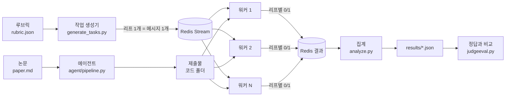
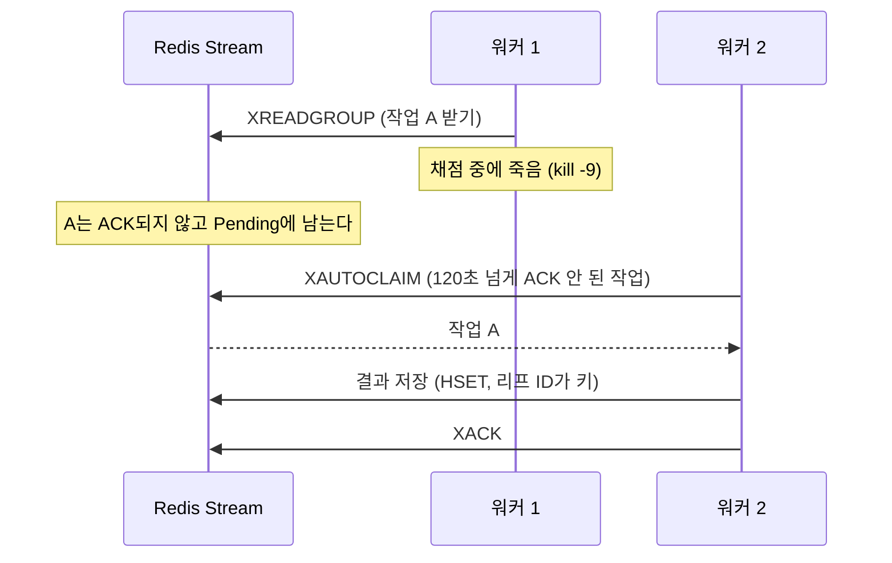

# 미니 PaperBench: 코드 설명

PaperBench([arXiv 2504.01848](https://arxiv.org/abs/2504.01848))를 작게 따라 만든 수업 프로젝트다.

- **에이전트**가 논문을 읽고 재현 코드를 쓴다.
- **judge**가 그 코드를 채점한다. 루브릭의 항목(리프)마다 0 또는 1을 준다.
- 채점은 **Redis 큐 + 워커 여러 개**로 나눠서 한다. 워커가 죽어도 작업이 이어진다.
- 마지막에는 **쿠버네티스(k3s)** 위에서 돌린다.

---

## 1. 전체 흐름



1. 에이전트가 논문으로 제출물(코드 폴더)을 만든다.
2. 작업 생성기가 루브릭의 리프마다 작업을 하나씩 큐에 넣는다.
3. 워커들이 작업을 나눠 가져가서 judge(LLM)로 채점한다.
4. 집계가 결과를 모아 `results/`에 JSON으로 저장한다.
5. 정답 라벨이 있으면 judge가 얼마나 정확한지 계산한다(F1 등).

---

## 2. 폴더 구조

```
mini-paperbench/
├── judge/        채점: judge 함수, 큐, 워커, 집계, 평가
├── agent/        에이전트: 논문 → 제출물 (P1~P5)
├── scripts/      설치, 데이터 준비, 실행 스크립트
├── docker/       Dockerfile 2개
├── k8s/          쿠버네티스 YAML과 실행 안내
├── datasets/     합성 논문 zip 2개 (judge 검증용)
├── results/      실험 결과 JSON
├── requirements.txt
└── .env.example  설정 예시 (키는 .env에 넣는다)
```

`data/`(논문, 제출물)와 `.env`(API 키)는 git에 올리지 않는다.

---

## 3. judge/ — 채점

| 파일 | 하는 일 |
| --- | --- |
| `judge.py` | **리프 1개를 LLM 1번 호출로 채점한다.** 결과는 `{"score": 0 또는 1, "reason": "..."}` |
| `rubric.py` | 루브릭 JSON에서 리프 목록을 뽑는다. 각 리프의 앞 맥락(상위 항목, 앞선 항목)도 같이 뽑는다 |
| `generate_tasks.py` | 리프마다 메시지 1개를 Redis Stream에 넣는다. 전체 작업 수도 적는다 |
| `worker.py` | 메시지를 받아 채점하고, 결과를 저장한 뒤 ACK한다. 죽은 워커의 작업도 가져간다 |
| `ratelimit.py` | 모든 워커가 같이 쓰는 속도 제한. 분당 요청 수와 분당 토큰 수를 지킨다 |
| `analyze.py` | 작업이 모두 끝나면 결과를 모아 `results/<run>.json`에 저장한다 |
| `judgeeval.py` | judge 결과를 정답 라벨과 비교한다. F1, macro-F1, 혼동 행렬 등을 계산한다 |
| `common.py` | Redis 주소, 키 이름, 설정값 |

### judge.py의 프롬프트

- 프롬프트 문장은 PaperBench 원본(SimpleJudge)에서 가져왔다.
- 순서: **논문 → addendum → 제출물 파일 → 채점 기준.**
  - 앞부분(논문, 제출물)이 리프마다 같다. 그래서 캐시 할인을 받는다(입력 토큰의 약 85~90%).
- 원본과 다른 점
  - 원본은 "관련 파일 고르기" 호출을 먼저 한다. 여기서는 제출물이 작아서 파일을 **전부** 넣는다. 그래서 리프당 호출이 1번이다.
  - 출력은 **JSON 스키마**로 받는다. 처음에는 JSON 모드를 썼는데, 따옴표가 깨져서 실패가 33%였다. 스키마로 바꾼 뒤 0%가 되었다.
- `MOCK_JUDGE=1`이면 LLM을 부르지 않는다. 몇 초 기다렸다가 0/1을 무작위로 준다. 큐와 워커를 시험할 때 쓴다.

### 큐와 장애 복구 (worker.py)



1. 워커는 채점하고 결과를 저장한 **뒤에** ACK한다.
2. 워커가 죽으면 그 작업은 ACK되지 않고 Pending 목록에 남는다.
3. 다른 워커는 새 작업을 읽기 전에 `XAUTOCLAIM`을 먼저 한다. 오래(`CLAIM_IDLE_SEC`) ACK되지 않은 작업을 가져간다.
4. 결과는 리프 ID를 키로 덮어쓴다. 같은 리프를 두 번 채점해도 결과는 1개다.
5. 3번 넘게 실패한 작업은 실패로 기록하고 끝낸다. 무한 반복을 막는다.

Redis 키 (run 이름이 `r1`일 때):

| 키 | 종류 | 내용 |
| --- | --- | --- |
| `pb:r1:tasks` | Stream | 작업. consumer group 이름은 `workers` |
| `pb:r1:total` | 문자열 | 전체 작업 수 |
| `pb:r1:meta` | 해시 | 논문 폴더, 제출물 폴더 경로 |
| `pb:r1:results` | 해시 | 리프 ID → 결과 JSON |
| `pb:r1:events` | 리스트 | 처리 시작/완료 기록 (중복 확인용) |
| `pb:rl:req:<분>`, `pb:rl:tok:<분>` | 문자열 | 속도 제한 카운터 (모든 run이 같이 씀) |

---

## 4. agent/ — 에이전트

정해진 단계를 순서대로 실행한다. 도구 호출 루프와 웹 검색은 없다. 코드를 실행하지도 않는다.

| 단계 | 하는 일 | 출력 |
| --- | --- | --- |
| P1 분석 | 핵심 기여, 방법, 실험 설정을 정리한다 | `analysis.md` |
| P2 설계 | 만들 파일 목록을 정한다 (최대 12개, JSON 스키마) | `plan.json` |
| P3 작성 | 파일마다 1번 호출한다. 코드 블록 1개만 받는다 | `src/*.py` |
| P4 점검 | 문법 검사(`py_compile`). 오류 파일을 다시 쓴다. import했지만 없는 모듈을 만든다 | 고친 파일 |
| P5 마무리 | 실행 안내와 실행 스크립트를 만든다 | `README.md`, `reproduce.sh`, `requirements.txt` |

- 입력: 논문(`paper.md`)과 `addendum.md`. `judge.addendum.md`는 judge 전용이라 주지 않는다.
- 호출 수 상한은 50번이다(`agent/llm.py`의 `MAX_CALLS`).
- 모든 중간 결과를 `data/agent_runs/<id>/`에 저장한다. 중간에 멈추면, 다시 실행할 때 끝난 단계는 건너뛴다.
- 호출 수, 토큰 수, 시간은 `results/agent_run_<id>.json`에 기록한다.

---

## 5. scripts/ — 실행 스크립트

| 스크립트 | 하는 일 |
| --- | --- |
| `fetch_data.sh` | PaperBench 저장소에서 논문, 루브릭, JudgeEval 제출물을 받아 `data/`에 둔다 |
| `import_synthetic.py` | 합성 논문 zip을 judge용 폴더와 정답 폴더로 나눠 푼다 |
| `ping_llm.py` | LLM 연결을 확인한다 ("say OK" 1번) |
| `judge_one.py` | 큐 없이 리프 몇 개만 바로 채점한다 (디버깅용) |
| `redis.sh` | 로컬 Redis(포트 6380)를 켜고 끈다 |
| `run_local.sh` | 로컬에서 채점 1번: 작업 생성 → 워커 N개 → 집계. `kill -9` 시험도 된다 |
| `run_synthetic.sh` | 합성 논문 × 제출물 5개를 채점하고 정답과 비교한다. `PAPERS`로 논문을 고른다 |
| `vllm_server.sh` | 연구실 GPU에 작은 모델(기본 Qwen2.5-7B)을 OpenAI 호환 API로 띄운다. judge 코드는 그대로 쓴다 |
| `bootstrap.sh` | (VM) k3s 설치부터 배포까지 한 번에. 여러 번 실행해도 안전하다 |
| `k8s_run.sh` | (VM) 클러스터에서 채점, 에이전트, 워커 수 변경, 워커 삭제 |
| `collect.sh` | (VM) `/data/results`를 로컬 `results/`로 가져온다 |

---

## 6. docker/, k8s/ — 컨테이너와 쿠버네티스

- 이미지 2개: `judge-worker`(워커, 작업 생성기, 집계가 같이 씀)와 `agent`.
- 상시 실행: Redis(Deployment + Service), judge 워커(Deployment).
- 한 번 실행: 작업 생성기, 집계, 에이전트(Job 템플릿, `k8s/jobs/`).
- 워커는 `RUN_ID` 환경 변수로 처리할 run을 정한다.
- 데이터는 노드의 `/data`(hostPath)에 둔다.
- 자세한 실행 방법은 [k8s/README.md](k8s/README.md)에 있다.

---

## 7. 빠른 시작 (로컬, 쿠버네티스 없이)

```bash
# 1. 환경
conda create -n pb -c conda-forge python=3.11 redis-server git-lfs
conda activate pb
pip install -r requirements.txt

# 2. 설정과 데이터
cp .env.example .env && chmod 600 .env     # .env에 LLM_API_KEY를 넣는다
scripts/fetch_data.sh
python scripts/import_synthetic.py datasets/synthetic_*.zip

# 3. MOCK으로 큐·워커 시험 (LLM 호출 없음): 작업 20개, 워커 3개
scripts/redis.sh start
MOCK_JUDGE=1 scripts/run_local.sh test1 20 3

# 4. 실제 judge로 합성 논문 검증
scripts/run_synthetic.sh syn

# 5. 에이전트 실행 후 채점
python -m agent.pipeline --run-id a1
GEN_ARGS="--submission-dir data/agent_runs/a1/submission --category 'Code Development'" \
  scripts/run_local.sh agent_a1 50 2

scripts/redis.sh stop
```

---

## 8. 설정 (환경 변수)

| 변수 | 기본값 | 뜻 |
| --- | --- | --- |
| `LLM_BASE_URL`, `LLM_MODEL`, `LLM_API_KEY` | Gemini | LLM 주소, 모델, 키. 바꾸면 OpenAI도 된다 |
| `MOCK_JUDGE`, `MOCK_DELAY_SEC` | `0`, `3` | 1이면 LLM 대신 무작위 점수 |
| `REDIS_URL` | `redis://localhost:6380/0` | Redis 주소 |
| `CLAIM_IDLE_SEC` | `120` | 이 시간 넘게 ACK 안 된 작업은 다른 워커가 가져간다 |
| `MAX_DELIVERIES` | `3` | 이 횟수를 넘으면 실패로 기록한다 |
| `RATE_LIMIT_RPM`, `RATE_LIMIT_TPM` | `15`, `250000` | 분당 요청 수, 분당 토큰 수 (모든 워커 합계) |

---

## 9. 지금까지 결과

모델: `gemini-3.5-flash-lite` (무료 등급)

| 실험 | 결과 | 파일 |
| --- | --- | --- |
| 워커 1·2·4개, MOCK 40개 | 120초 → 60초 → 30초 (거의 정비례) | `results/t3_w*.json` |
| 채점 중 워커 `kill -9` | 20/20 완료, 중복 없음 | `results/t2_kill.json` |
| JudgeEval (사람 채점 77개) | F1 0.986, macro-F1 0.893 | `results/judgeeval_gemini-3.5-flash-lite.json` |
| 합성 논문 (정답 188개) | F1 0.986, macro-F1 0.972, 0점 47개 모두 맞힘 | `results/judgeeval_syn_gemini-3.5-flash-lite.json` |
| 에이전트 제출물 (Code-Dev 50개) | a1 0.92, a2 0.92 | `results/agent_a*_codedev.json` |
| 합성 논문 6편 (정답 476개), Gemini | F1 0.967, macro-F1 0.937, 0점 재현율 0.966 | `results/judgeeval_syn6_gemini-3.5-flash-lite.json` |
| 로컬 Qwen2.5-7B judge (합성 6편, JudgeEval) | macro-F1 0.703, 0.413. Gemini보다 크게 낮다 | `reports/2026-10-15.md` |

주의할 점

- JudgeEval은 정답의 94%가 1이다. "전부 1점"만 줘도 F1이 0.966이다. 그래서 합성 논문으로 따로 검증했다.
- 합성 논문은 실제 논문보다 짧고 깔끔하다. 실제보다 점수가 좋게 나올 수 있다.
- judge의 약점: 다른 리프에서 볼 오류로 이 리프를 감점하는 경우가 있다(합성 논문에서 4번).
- 에이전트 점수는 "코드가 있는가"만 본 것이다. 코드를 실행하지는 않았다.
